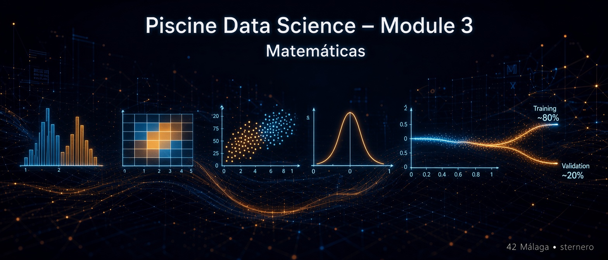

# 📐 Matemáticas del Module 3 – The present

<p align="center">
  
</p>

Documento **didáctico**: no sustituye al subject ni a los scripts (`Histogram.*`, `Correlation.*`, …).  
Sirve para entender **con calma** las cuentas detrás de cada ejercicio, **sin dar por sentado** que ya sabes estadística.

> **Analogía global:** cada fila del CSV es un caballero. Las columnas numéricas son “skills” (features).  
> En Train hay además la columna **`knight`** (Jedi / Sith): el **target**, la etiqueta que queremos entender.  
> Test es el mismo tipo de ficha **sin** la etiqueta.

> **Sobre las fórmulas:** cuando aparezca un símbolo, debajo hay tabla o ejemplo numérico. No hace falta memorizar la notación: sirve para ver **de dónde sale** el número.

---

## 📑 Índice

1. [Ideas base (filas, columnas, target)](#ideas-base)
2. [EX00 – Histogramas](#ex00)
3. [EX01 – Correlación de Pearson](#ex01)
4. [EX02 – Puntos en el plano](#ex02)
5. [EX03 – Estandarización (z-score)](#ex03)
6. [EX04 – Normalización (min-max)](#ex04)
7. [EX03 vs EX04 – Diferencia (hoja de evaluación)](#diff)
8. [EX05 – Split Training / Validation](#ex05)
9. [Cómo leer cada gráfico (títulos y pies en español)](#graficos)
10. [Mini glosario](#glosario)
11. [Cómo usarlo en la defensa](#defensa)

---

## 1. Ideas base {#ideas-base}

| Concepto | En cristiano |
|----------|----------------|
| **Feature (skill)** | Una característica medible (fuerza, sensibilidad…) |
| **Target (`knight`)** | La respuesta: de qué bando es el caballero |
| **Train** | Datos **con** respuesta (aprendemos relaciones) |
| **Test** | Datos **sin** respuesta (mismo formato de skills) |

**Codificar el target para correlaciones:**  
Jedi / Sith son texto. Para calcular números, se suele mapear a 0 y 1 (p. ej. Sith=0, Jedi=1).  
Eso no “cambia la realidad”: solo permite aplicar fórmulas numéricas.

[↑ Volver al índice](#indice)

---

## 2. EX00 – Histogramas {#ex00}

### Qué pregunta responde

> ¿Cómo se reparte cada skill? ¿Jedi y Sith se solapan en esa skill?

### Idea

Para una skill, se dividen los valores en **cajones (bins)** y se cuenta cuántos caballeros caen en cada cajón.

**Analogía:** medir la altura de todos en una clase y levantar un edificio por cada tramo (1,50–1,60; 1,60–1,70…).

### Eje X y eje Y

| Eje | Significado |
|-----|------------|
| **X** | Valor de la skill (p. ej. Strength de 10 a 30) |
| **Y** | **Cuántos** caballeros tienen un valor en ese tramo |

No es “tiempo”. No es “precio medio”. Es **frecuencia** (conteo).

### Train vs Test

- **Train:** a menudo dos colores (Jedi / Sith) en el mismo histograma → se ve si los bandos se separan o se pisan.  
- **Test:** sin `knight` → un solo color; solo la forma de la distribución.

**Qué recordar en defensa:**  
“El histograma muestra la distribución de cada skill; en Train comparamos bandos.”

[↑ Volver al índice](#indice)

---

## 3. EX01 – Correlación de Pearson {#ex01}

### Qué pregunta responde

> ¿Qué skills van más “de la mano” del bando (`knight`)?

### Fórmula de Pearson

Para dos listas de números \(x_1,\ldots,x_n\) e \(y_1,\ldots,y_n\) (misma longitud):

$$
r = \frac{\sum_{i=1}^{n}(x_i - \bar{x})(y_i - \bar{y})}
{\sqrt{\sum_{i=1}^{n}(x_i - \bar{x})^2}\;\sqrt{\sum_{i=1}^{n}(y_i - \bar{y})^2}}
$$

| Símbolo | Significado |
|---------|-------------|
| \(\bar{x}, \bar{y}\) | medias de cada lista |
| \(x_i - \bar{x}\) | cuánto se aparta el valor \(i\) de su media |
| Numerador | si cuando \(x\) sube, \(y\) también sube, el producto tiende a ser positivo |
| Denominador | normaliza para que \(r\) quede entre **−1 y +1** |

### Cómo interpretarlo

| Valor de \(r\) | Lectura cotidiana |
|----------------|-------------------|
| \(r = 1\) | Relación lineal perfecta positiva (suben juntos) |
| \(r \approx 0\) | Poca relación **lineal** |
| \(r = -1\) | Relación lineal perfecta negativa (uno sube, el otro baja) |
| \(\|r\|\) grande | Señal fuerte (útil para el target) |
| \(\|r\|\) pequeño | Esa skill apenas ayuda a predecir el bando de forma lineal |

**Analogía:** si cada vez que hace más calor vendes más helados, calor y ventas tienen \(r\) alto y positivo.

### Por qué `knight = 1`

Cualquier lista correlacionada **consigo misma** da \(r = 1\).  
Es un control: si `knight` no sale 1, algo falló al codificar o al calcular.

### Ejemplo minúsculo

\(x = (1, 2, 3)\), \(y = (2, 4, 6)\) → \(y = 2x\) → \(r = 1\).  
\(y = (3, 2, 1)\) → relación inversa → \(r = -1\).

**Qué exigir la hoja:** lista de factores + explicación oral de “qué es un correlation factor”.

[↑ Volver al índice](#indice)

---

## 4. EX02 – Puntos en el plano {#ex02}

### Qué pregunta responde

> Si miro **dos** skills a la vez, ¿se separan Jedi y Sith o se mezclan?

### Idea

Cada caballero = un punto \((x, y)\) donde \(x\) e \(y\) son dos skills.

- **Par que separa:** nubes de color distintas (p. ej. skills muy correlacionadas con el target).  
- **Par que mezcla:** colores entremezclados (skills poco ligadas al target).

**Train:** colores por `knight`.  
**Test:** un solo color (no hay etiqueta).

**Analogía:** en un mapa “altura × peso”, hombres y mujeres a veces forman nubes distintas; con “talla de zapato × favorito de color” puede no haber separación.

No hay fórmula nueva: es **visualización** de dos columnas. La matemática de fondo es la misma correlación que ya viste en EX01 (elegir buenos/malos pares).

[↑ Volver al índice](#indice)

---

## 5. EX03 – Estandarización (z-score) {#ex03}

### Qué pregunta responde

> ¿Cómo pongo todas las skills en la **misma regla** para compararlas?

### Fórmula

Para cada valor \(x\) de una skill:

$$
z = \frac{x - \mu}{\sigma}
$$

| Símbolo | Significado |
|---------|-------------|
| \(x\) | valor original |
| \(\mu\) | **media** de esa skill en el fichero |
| \(\sigma\) | **desviación típica** de esa skill |
| \(z\) | valor estandarizado |

### Desviación típica (recordatorio)

$$
\sigma = \sqrt{\frac{1}{n}\sum_{i=1}^{n}(x_i - \mu)^2}
$$

(En algunos contextos se usa \(n-1\); lo importante es “dispersión respecto a la media”.)

### Qué hace numéricamente

- Media de los \(z\) ≈ **0**  
- Dispersión de los \(z\) ≈ **1**  
- La **forma** relativa de los puntos se mantiene; **cambian los ejes** del gráfico.

**Analogía:** medir a todo el mundo en “cuántas desviaciones se aparta de la media de la clase”, no en centímetros crudos.

**Subject:** imprimir datos (antes/después) y un scatter de EX02 ya estandarizado; Train y Test.

[↑ Volver al índice](#indice)

---

## 6. EX04 – Normalización (min-max) {#ex04}

### Qué pregunta responde

> ¿Cómo reescalo cada skill a un tramo fijo, p. ej. entre 0 y 1?

### Fórmula (min-max)

$$
x' = \frac{x - x_{\min}}{x_{\max} - x_{\min}}
$$

| Símbolo | Significado |
|---------|-------------|
| \(x_{\min}, x_{\max}\) | mínimo y máximo de esa skill |
| \(x'\) | valor normalizado ∈ **[0, 1]** (si \(x\) está entre min y max) |

**Ejemplo:** skill de 10 a 50; valor 30 → \(x' = (30-10)/(50-10) = 0{,}5\).

**Analogía:** el volumen del móvil de 0 a 100, da igual si el altavoz es pequeño o grande: 0 = silencio, 1 = máximo.

**Subject:** imprimir datos normalizados y gráficos de EX02 con esa escala; Train y Test.

[↑ Volver al índice](#indice)

---

## 7. EX03 vs EX04 – Diferencia (ítem de la hoja) {#diff}

La hoja de evaluación pregunta **explícitamente** la diferencia.

| | **Estandarización (EX03)** | **Normalización (EX04)** |
|--|----------------------------|---------------------------|
| **Fórmula típica** | \(z = (x-\mu)/\sigma\) | \(x' = (x-x_{\min})/(x_{\max}-x_{\min})\) |
| **Ancla** | media y dispersión | mínimo y máximo |
| **Resultado habitual** | centro ≈ 0, std ≈ 1 | valores en [0, 1] |
| **Sensible a** | outliers (inflan \(\sigma\)) | extremos min/max |
| **Analogía** | “¿cuántas desviaciones del promedio?” | “¿qué % del recorrido min→max?” |

**Frase lista para defensa:**  
“Estandarizar centra y escala con media y std; normalizar comprime al intervalo [0,1] con min y max. En ambos casos el gráfico de puntos cambia de ejes pero cuenta la misma historia con otra regla.”

[↑ Volver al índice](#indice)

---

## 8. EX05 – Split Training / Validation {#ex05}

### Qué pregunta responde

> ¿Qué parte del Train uso para **ajustar** y qué parte dejo para **comprobar** sin hacer trampa?

### Idea

Se baraja (aleatorio) `Train_knight.csv` y se parte en dos ficheros:

| Fichero | Rol |
|---------|-----|
| `Training_knight.csv` | Aprender / ajustar |
| `Validation_knight.csv` | Estimar calidad **sin** haber usado esas filas al ajustar |

### Porcentajes (hay que poder explicarlos)

Un ratio muy habitual:

$$
\sim 80\,\% \rightarrow \text{Training}, \qquad \sim 20\,\% \rightarrow \text{Validation}
$$

**Por qué no 100 % training:**  
Si mides el acierto solo con los mismos datos con los que ajustaste, puedes **sobreestimar** (como estudiar solo con el examen resuelto).

**Por qué no 50/50 siempre:**  
Más training suele ayudar a aprender; la validation debe ser suficiente para ser representativa. 80/20 es un compromiso clásico; **otro ratio es válido si se justifica**.

**Analogía:** practicas con 80 flashcards y te examinas con las 20 que no miraste.

**Subject / hoja:** ejecutar `./split.* Train_knight.csv` y ver aparecer ambos CSV; explicar %.

[↑ Volver al índice](#indice)

---


---

## 9. Cómo leer cada gráfico (títulos y pies en español) {#graficos}

Esta sección fija **qué debería verse** en cada PNG y qué texto (título / pie) ayuda en la defensa.  
Los **nombres de skills** del CSV (`Strength`, `Awareness`…) se dejan como en los datos; el resto del texto del gráfico puede ir en español claro.

> Idea: quien abre el PNG sin haber leído el código debe entender en 10 segundos **qué pregunta responde el dibujo**.

### 9.1 EX00 – Histograma Test (`histogram_test.png`)

| Parte del gráfico | Texto / lectura amigable |
|-------------------|---------------------------|
| **Título** | Test – cómo se reparte cada habilidad (sin saber el bando) |
| **Qué es cada casilla** | Un histograma de **una** skill del CSV |
| **Eje X** | Valor de esa skill (de menor a mayor) |
| **Eje Y** | **Cuántos** caballeros tienen un valor en ese tramo (no es tiempo ni dinero) |
| **Colores** | Un solo color: el Test **no** trae la columna `knight` |
| **Pie sugerido** | «No hay Jedi/Sith aquí: solo miramos la forma de cada distribución.» |

**Analogía:** contar cuántas personas miden entre 1,60–1,70 m, 1,70–1,80 m, etc. El “edificio” de cada tramo es la barra del histograma.

### 9.2 EX00 – Histograma Train (`histogram_train.png`)

| Parte del gráfico | Texto / lectura amigable |
|-------------------|---------------------------|
| **Título** | Train – misma idea, pero coloreado por bando (Jedi / Sith) |
| **Qué se ve** | Los mismos tipos de histograma, con **dos colores** superpuestos |
| **Leyenda** | Un color = Jedi · otro = Sith |
| **Cómo interpretarlo** | Si los colores se **separan** en una skill → esa habilidad ayuda a distinguir bandos. Si se **solapan** → esa skill sola no separa bien. |
| **Pie sugerido** | «Eje X = valor de la skill · Eje Y = número de caballeros. Colores = bando.» |

### 9.3 EX01 – Lista de correlación (consola / informe)

No es un PNG obligatorio del subject, pero la **salida** debe leerse así:

| Qué aparece | Cómo entenderlo |
|-------------|-----------------|
| `knight → 1.000` | Control: una variable correlacionada **consigo misma** siempre da 1 |
| Valores cercanos a **±1** | Relación lineal **fuerte** con el bando |
| Valores cercanos a **0** | Poca relación **lineal** con el bando |
| Orden de la lista | De más relacionada a menos (típico) |

**Frase de defensa:** «Pearson mide si dos listas suben y bajan juntas; no implica causa-efecto.»

### 9.4 EX02 – Cuatro paneles de puntos (`points`)

**Idea global:** cada **punto** = un caballero; los **ejes** = dos skills.

#### Train – par que separa

| Parte | Texto amigable |
|-------|----------------|
| **Título** | Train – dos skills que **SÍ** separan los bandos |
| **Qué se ve** | Nubes de color (Jedi / Sith) **aparte** |
| **Pie** | «Con solo estas dos medidas ya se intuye el bando.» |

#### Train – par que mezcla

| Parte | Texto amigable |
|-------|----------------|
| **Título** | Train – dos skills que **NO** separan bien (se mezclan) |
| **Qué se ve** | Colores **entremezclados** |
| **Pie** | «Estas dos skills apenas cuentan el bando por sí solas.» |

#### Test – mismos ejes (dos paneles)

| Parte | Texto amigable |
|-------|----------------|
| **Título** | Test – mismos ejes que arriba (aquí no sabemos el bando) |
| **Qué se ve** | Los mismos pares de skills; **un solo color** |
| **Pie** | «Sin etiqueta `knight` no podemos pintar Jedi/Sith; solo la posición en el plano.» |

**Analogía:** en un mapa altura × peso a veces se ven dos grupos; en talla de zapato × color favorito puede no haber grupos claros.

### 9.5 EX03 – Scatter tras estandarizar

| Parte | Texto amigable |
|-------|----------------|
| **Título** | EX03 – mismo gráfico de separación, pero en escala **estandarizada** |
| **Ejes** | Skill (estandarizada: media ≈ 0, dispersión ≈ 1) |
| **Qué cambia** | Los **números** de los ejes; la **forma relativa** de la nube se mantiene |
| **Pie** | «Cada valor: z = (x − media) / desviación. Todas las skills hablan la misma regla.» |

### 9.6 EX04 – Scatter tras normalizar

| Parte | Texto amigable |
|-------|----------------|
| **Título** | EX04 – puntos con skills reescaladas de **0 a 1** |
| **Ejes** | Skill (normalizada entre 0 y 1) |
| **Qué cambia** | 0 = mínimo de esa skill en el fichero · 1 = máximo |
| **Pie** | «Fórmula: (x − mínimo) / (máximo − mínimo). No es lo mismo que el z-score de EX03.» |

### 9.7 EX05 – No hay gráfico, pero sí “qué mirar”

| Salida | Lectura |
|--------|---------|
| `Training_knight.csv` | Parte del Train para **ajustar** (p. ej. ~80 %) |
| `Validation_knight.csv` | Parte **reservada** para comprobar sin hacer trampa (p. ej. ~20 %) |

**Por qué:** si validas solo con los mismos datos del ajuste, puedes creer que aciertas más de la cuenta (como estudiar solo con el examen resuelto).

### 9.8 Ejemplo de código (título + pie en matplotlib)

```python
fig.suptitle(
    "Train – distribución de cada habilidad según el bando (Jedi / Sith)",
    fontsize=12,
)
fig.text(
    0.5, 0.02,
    "Cada panel = una skill. Eje X: valor · Eje Y: cuántos caballeros. "
    "Colores: bando. Si se solapan, esa skill no separa bien.",
    ha="center", fontsize=8, style="italic",
)
# fig.savefig(..., bbox_inches="tight", pad_inches=0.35)
```

> Esto **no** lo exige el subject; es una mejora de claridad para defensa y para quien lea el PNG sin el código.

[↑ Volver al índice](#indice)


## 10. Mini glosario {#glosario}

| Término | En una línea |
|---------|----------------|
| **Bin** | Cajón del histograma |
| **Feature** | Columna predictora (skill) |
| **Target** | Columna a explicar (`knight`) |
| **Pearson \(r\)** | Correlación lineal entre −1 y 1 |
| **z-score** | \((x-\mu)/\sigma\) |
| **Min-max** | Reescalado a [0, 1] |
| **Training** | Subconjunto para ajustar |
| **Validation** | Subconjunto para comprobar sin filtrar |

[↑ Volver al índice](#indice)

---

## 11. Cómo usarlo en la defensa {#defensa}

| Ejercicio | Frase útil |
|-----------|------------|
| **EX00** | “Histograma = distribución de cada skill; Train colorea el bando.” |
| **EX01** | “Pearson mide relación lineal; knight=1 consigo mismo; ordeno \|r\|.” |
| **EX02** | “Dos skills en el plano; un par separa bandos y otro los mezcla.” |
| **EX03** | “z = (x−μ)/σ; mismos puntos, ejes en desviaciones.” |
| **EX04** | “x' = (x−min)/(max−min); ejes en [0,1].” |
| **EX03–04** | “Media/std vs min/max; no son lo mismo.” |
| **EX05** | “~80/20 aleatorio; validation no se usa para ajustar.” |

### Relacionado en este repo

| Recurso | Rol |
|---------|-----|
| `ex0N/python.md` | Cómo está escrito el código |
| `ex0N/README.md` | Subject y checklist del ejercicio |
| `evaluation.sh` | Guía de defensa (no es nota) |
| `mates.md` | Este documento |

---

*mates.md · Module 3 The present · material de apoyo · no sustituye en.subject.pdf*  
*sternero – 42 Málaga – 2026*
